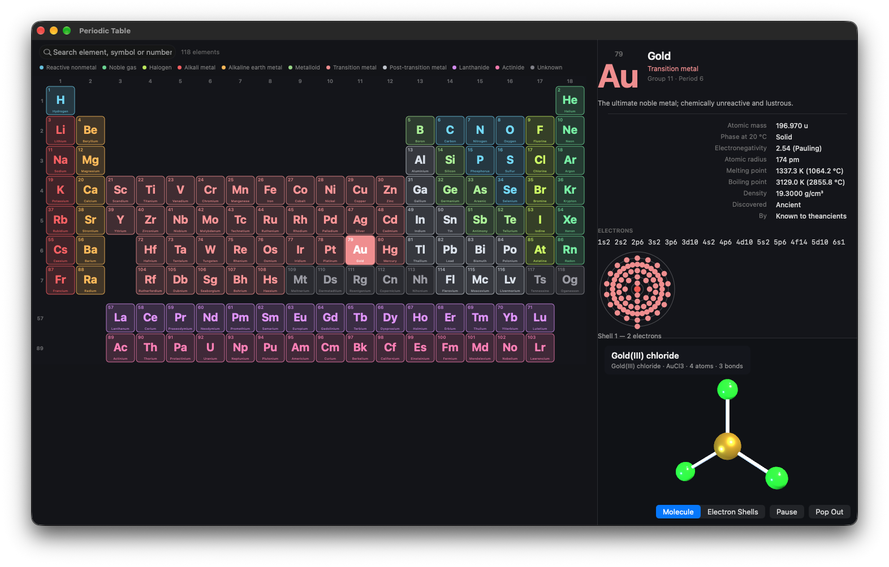

# Periodic Table for macOS

A native macOS app for exploring all 118 chemical elements. Pick any element and the right-hand
pane fills with its properties, uses and history, while a 3D model of a related molecule — or an
animated model of the atom itself — turns slowly below it.

The app is written in Objective-C with AppKit and SceneKit, uses no storyboards, and works
entirely offline.



## The periodic table

The main window shows the complete IUPAC table: 18 groups across, 7 periods down, with the
lanthanides and actinides in two separate rows underneath. Group numbers run along the top and
period numbers down the left.

Each tile shows the atomic number and symbol, plus the name when the tile is wide enough, all
painted in the colour of its category. A legend above the table names all 11 categories:

- alkali metal
- alkaline-earth metal
- transition metal
- post-transition metal
- metalloid
- reactive nonmetal
- halogen
- noble gas
- lanthanide
- actinide
- unknown

**Carbon is selected when the app opens** so the window is never empty.

### Searching

The search field at the top filters as you type. It matches an element's name, symbol, atomic
number, category name or summary; everything that does not match fades into the background and
the counter switches from `118 elements` to, for example, `6 of 118 elements`. Clearing the field
restores the whole table.

The legend is a colour key, not a filter.

## The element panel

Selecting a tile updates the right-hand pane immediately. The panel scrolls above a fixed-height
3D viewport and contains:

- **Header** — large symbol, atomic number, name, category, group/period, and a short summary.
- **Properties** — atomic mass, phase at 20 °C, electronegativity (Pauling), atomic radius,
  melting point, boiling point, density, year discovered, and discoverer. Unknown values are
  shown as `—`.
- **Electrons** — the full electron configuration in monospaced text, a 2-D Bohr-style shell
  diagram, and a shell-by-shell electron count.
- **Common uses** — a bulleted list.
- **Discovery** — year and discoverer.
- **3D model** — the name, formula, description and atom/bond counts of the molecule shown
  below.

## The 3D viewer

The bottom of the right-hand pane is a SceneKit viewport with two modes, selected with the
segmented control or the View menu.

### Molecule mode

Shows a molecule or crystal related to the selected element. Atoms are coloured per element
(CPK-style) and sized from covalent radii; bonds are drawn as cylinders. Salts such as sodium
chloride appear as a 3×3×3 rock-salt lattice, caesium chloride as its 8+1 cubic cell. Several
noble gases are shown as monatomic models. Elements without a well-known compound fall back to
one atom of the element, so this pane is never blank.

The molecule turns slowly around its vertical axis at a constant speed, so bonds stay attached
to their atoms.

### Electron-shell mode

Shows the atom itself: a nucleus built from proton and neutron spheres, one ring per electron
shell, and electrons orbiting on tilted paths. The nucleus spins while the electrons circle.
The overlay shows the element name, the electron count, the shell populations and the electron
configuration.

### Camera controls

- **Drag** to orbit the model.
- **Scroll** to zoom between 0.25× and 3× the framed distance.
- Moving the pointer over the view does nothing — no shimmer, no accidental camera drift.
- **Pause / Play** freezes or resumes the animation.
- **Pop Out** opens the current model in a resizable 720 × 560 window. The pop-out has the same
  orbit and zoom controls, and closes with `⌘W`.

The model is framed to fit the viewport exactly, including atom radii, and re-fits when the
window is resized while keeping your current orbit and zoom. The viewport itself stays 330 pt
tall for every element, so switching elements never changes the window layout.

## Menus and keyboard

| Action | Shortcut / menu |
|---|---|
| Focus the search field | `⌘F` (Edit ▸ Find Element) |
| Move the selection | Arrow keys |
| Show the molecule | `⌘1` (View ▸ Show Molecule) |
| Show electron shells | `⌘2` (View ▸ Show Electron Shells) |
| Enlarge the app window | `⌘+` (View ▸ Zoom In) |
| Shrink the app window | `⌘-` (View ▸ Zoom Out) |
| Minimize | `⌘M` |
| Close the frontmost window | `⌘W` |
| Quit | `⌘Q` |

Note that View ▸ Zoom In / Zoom Out resizes the application window; zooming the 3D model itself
is done by scrolling over it.

## Requirements

| Tool | Version |
|---|---|
| macOS | 13.0 or later |
| Xcode | 14 or later |
| [XcodeGen](https://github.com/yonaskolb/XcodeGen) | 2.46 tested |
| Python | 3.x, only for regenerating the element data |

## Build and run

```bash
cd periodic-table

xcodegen generate

xcodebuild -project PeriodicTable.xcodeproj -scheme PeriodicTable \
           -configuration Debug -derivedDataPath build \
           CODE_SIGNING_ALLOWED=NO build

open build/Build/Products/Debug/PeriodicTable.app
```

After `xcodegen generate` you can also open `PeriodicTable.xcodeproj` in Xcode and press Run.
Code signing is disabled in `project.yml` for local builds; enable it if you want to distribute
the app.

## Data

All content comes from `PeriodicTable/Resources/elements.json`:

- **118 elements** — number, symbol, name, mass, category, group, period, f-block flag, electron
  configuration, shell populations, electronegativity, atomic and covalent radius, melting and
  boiling points, density, phase, discovery year, discoverer, molecule reference, uses and
  summary.
- **144 molecules** — name, formula, description, shape, atoms, bonds and optional explicit
  coordinates.

Every element maps to a molecule entry, and the app displays representative compounds rather
than every known compound of an element.

The JSON is generated from the compact table in `tools/generate_elements.py`. The generator
derives electron shells from the configuration string, checks that they sum to the atomic
number, validates all 118 elements and verifies molecule coordinates and bond lengths. To change
the data, edit the script and run:

```bash
python3 tools/generate_elements.py
```

## Project layout

```
periodic-table/
├── README.md
├── AGENTS.md                     Detailed development plan and design rationale
├── project.yml                   XcodeGen specification
├── tools/
│   └── generate_elements.py      Data source and JSON generator
└── PeriodicTable/
    ├── App/                      Entry point, window, split view, menus
    ├── Model/                    Elements, categories, molecules, JSON store
    ├── Views/                    Table, 2-D shell diagram, SceneKit scenes, camera view
    ├── Controllers/              Table, detail pane, 3-D pane
    ├── Support/                  Colour parsing and vector helpers
    └── Resources/
        └── elements.json         118 elements and 144 molecules
```

### Under the hood

- The periodic table is a custom-drawn `NSView`, not a collection view; it paints all 118 tiles
  and adapts its tile size to the available width.
- Molecule geometry is described declaratively (`tetrahedral`, `cubic-na`, `ring-with-h`, …) and
  coordinates are generated at load time, so the data file cannot contain broken geometry.
- The 3D pane, split divider and long labels are constrained so the window stays the same size
  as you move from hydrogen to oganesson.
- SceneKit runs at 60 fps with 4× multisampling; the molecule has a single calm turntable
  rotation rather than pulsing or multi-axis motion.
- Camera orbit and zoom are implemented directly on the camera node, with the built-in hover
  camera control disabled.
- Pop-out windows are retained by the 3D controller and released when closed.

## Notes and limits

- The app is fully offline; it makes no network requests.
- Heavy atoms are capped at 42 rendered nucleons in electron-shell mode to keep the frame rate
  smooth.
- The interface is in English.
- The 3D pane is 330 pt tall and the window cannot be made smaller than 1040 × 620.
